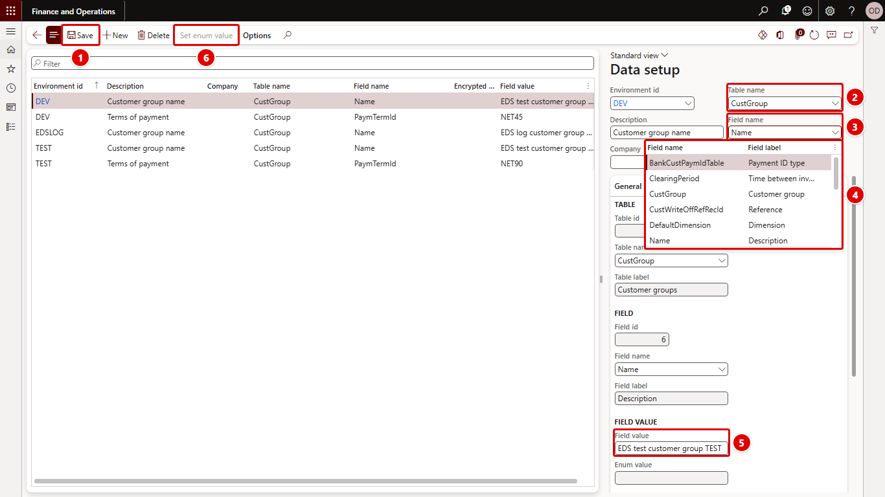

[← Return to README](../README.md)

# Data setup

**System administration > Setup > Environment data setup > Data setup** (form `OLK_EnvironmentDataSetupTrans`, table `OLK_EnvironmentDataSetupTrans`)

A data setup line says: in environment *E*, write value *V* to field *F* of the record with RecId *R* in table *T* of company *C*. When the setup is [executed](execute.md) with **Execute data**, every line of the environment is written.

The red numbers in each screenshot match the numbered steps below it.

1. Click **Edit** (or **New** for a new line).
2. **Table name**: enter or look up the table, for example `CustGroup`.
3. **Field name**: press **Alt+Down** or click the arrow to open the lookup.
4. The lookup lists the table's fields with their labels. Pick one with the arrow keys and **Enter**, or click it.
5. **Field value**: enter the value to write in the environment.
6. **Set enum value** picks the value from the enum's values. It is enabled only for enum fields, so it is unavailable here for the string field `Name`.

## Fields

| Field | Description |
| --- | --- |
| Environment id | The [environment](environments.md) the line belongs to. |
| Description | What the line is for. Lines created from the Personalize pop-up get the control's label. |
| Company | The company of the record. Filled with the current company for company specific tables and cleared for shared tables when you pick the table. Required for company specific tables. |
| Table name / Table id / Table label | The table that holds the record. Enter the table's AOT name; the id and label are shown. Changing the table clears the field. |
| Field name / Field id / Field label | The field to write. The lookup lists the fields of the table. For an encrypted field this is the edit method instead (see below). |
| Field value | The value to write, as culture independent text (see below). Encrypted values are shown as `********`. |
| Enum value | For enum fields, the label of the value. |
| Record id | The RecId of the record to update. |
| Encrypted field / Edit method name | See [Encrypted fields](#encrypted-fields). |

A line is unique per environment, company, table, record, field and edit method.

## Validation when you save

- The table must exist.
- The field must exist on the table, or for an encrypted field the edit method must exist on the table.
- A company is required when the table is company specific.
- The record must exist: a record with that RecId must be found in the line's company.

## Value format

Values are stored as text that does not depend on the user's language or regional settings:

| Field type | Format | Example |
| --- | --- | --- |
| String | As is | `Contoso UAT` |
| Integer, Int64 | Digits | `42` |
| Real | Dot as decimal separator | `12.5` |
| Date | `yyyy-mm-dd` | `2026-10-15` |
| Date and time | ISO 8601 | `2026-10-15T07:00:00` |
| Enum | The enum value number | `1` |
| GUID | Standard GUID text | |

Other field types (containers, for example) are not supported; executing such a line logs *Fields of type X are not supported.*

For enum fields you can type the number, the symbol (`Yes`) or the label; the form stores the number. **Set enum value** opens a dialog with the enum's values to pick from; it is enabled only when the line's field is an enum field.

## Encrypted fields

Encrypted fields cannot be assigned directly. Set **Encrypted field** to Yes and enter, in **Edit method name**, the name of the edit method on the table that sets the value. At execution the edit method is called with the value. The value is masked in the form and is not written to the log.

## Adding lines

- From any form: open the Personalize pop-up on a field and select **Create environment data**. This adds the field with its current value; you then change the value here. See [Adding data setup lines from any form](personalization.md).
- By hand: select the environment, enter the table name, pick the field from the lookup, and enter the company, record id and value.

## What happens at execution

For each line of the environment, in its company:

1. The record is selected for update by RecId. If it is not found, the line is logged as Error.
2. The current value is read and kept as the original value for the log.
3. The new value is converted to the field's type and assigned (for encrypted fields the edit method is called instead).
4. `validateField` and `validateWrite` of the table must pass; otherwise the line is logged as Error and the record is not changed.
5. The record is updated with `update()`, so the table's own update logic runs.

Each line runs in its own transaction, so one failing line does not stop the others. See [Executing the setup](execute.md) and [Log](log.md).
