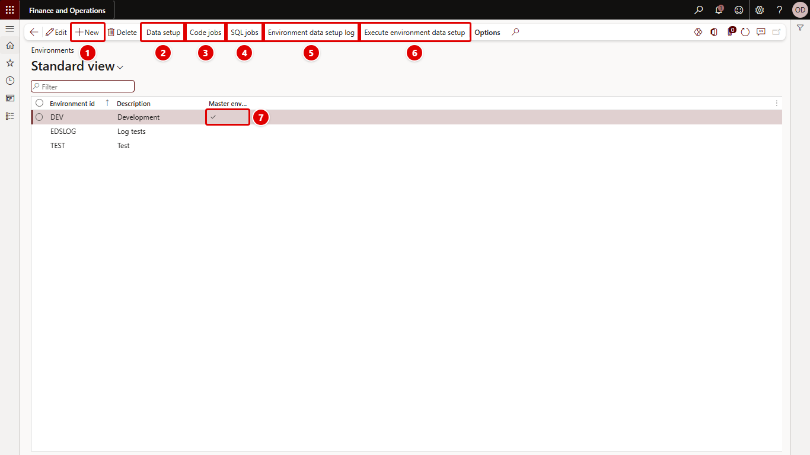

[← Return to README](../README.md)

# Environments

**System administration > Setup > Environment data setup > Environments** (form `OLK_EnvironmentDataSetupTable`)

An environment is one Dynamics 365 Finance and Operations environment that the setup can be executed for, for example `PROD`, `UAT`, `TEST` or `DEV`. Every data setup line, code job and SQL job belongs to one environment.

The red numbers in each screenshot match the numbered steps below it.

1. **New** adds an environment: enter **Environment id** and **Description**.
2. **Data setup** opens the data setup lines of the selected environment.
3. **Code jobs** opens its code jobs.
4. **SQL jobs** opens its SQL jobs.
5. **Environment data setup log** opens the execution log.
6. **Execute environment data setup** runs the setup for the selected environment.
7. **Master environment** marks the master. Only one environment can be the master.

The **Encryption** group (**Fetch key**, **Import enrolment**, **Export enrolment**, **Encrypt plain values**) and the columns **Environment URL**, **Client ID**, **Tenant ID**, **Client secret**, **Key status**, **Key fingerprint** and **Key enrolled** are not in the screenshot yet; see [Encrypted values for each environment](encryption.md).

## Fields

| Field | Description |
| --- | --- |
| Environment id | Identifies the environment, up to 20 characters. Must be unique. |
| Description | Free text. |
| Master environment | The environment where the setup is maintained. Only one environment can be the master; saving a second one fails with *Environment X is already marked as the master environment.* |
| Environment URL | The URL of the environment, for example `https://contoso-uat.sandbox.operations.dynamics.com`. Required. Only the host name counts, and two environments cannot have the same host. The setup of an environment with encrypted values can be executed only in the environment with this URL. |
| Client ID, Tenant ID, Client secret | The Microsoft Entra ID application the master uses to call the environment's key service. Optional; without them, use an enrolment file. The secret is stored encrypted and never shown. |
| Key status | *No key*, *Enrolled*, *Usable here* or *Cannot be unlocked here*. |
| Key fingerprint | SHA-256 of the environment's public key. |
| Key enrolled | When the key was stored. |

Existing environment records have no URL; enter it the next time you edit them, because saving a record without a URL fails.

The master environment is also what the **Create environment data** button in the Personalize pop-up proposes (see [Adding data setup lines from any form](personalization.md)) and what **Create code jobs** proposes when nothing else is known (see [Code jobs](code-jobs.md)).

## Why there is a master

The setup tables are ordinary tables in the database, so they are copied together with everything else when a database is refreshed. Maintain the setup of every environment in one place, normally the production environment, and mark it as master. After PROD is copied to UAT, the UAT setup arrives with the copy and you execute it in UAT.

Data setup lines point at records by RecId, which a database copy keeps. That is why the lines are created in the environment the data is copied from.

Secrets for an environment are kept in the master too, encrypted so that only that environment can read them. See [Encrypted values for each environment](encryption.md).

## Buttons

| Button | What it does |
| --- | --- |
| Data setup | Opens [Data setup](data-setup.md) for the selected environment. |
| Code jobs | Opens [Code jobs](code-jobs.md) for the selected environment. |
| SQL jobs | Opens [SQL jobs](sql-jobs.md) for the selected environment. |
| Environment data setup log | Opens the [log](log.md) for the selected environment. |
| Execute environment data setup | Opens the [execution dialog](execute.md) with the selected environment filled in. |
| Fetch key | Gets the selected environment's encryption key from its key service. If the service cannot be called, opens that environment's Environments page in a new tab, to export an enrolment file there. See [Encrypted values](encryption.md). |
| Import enrolment | Stores the key from an enrolment ZIP file in the selected environment's record. |
| Export enrolment | Downloads the enrolment ZIP file of the environment you are in. No record needs to be selected. |
| Encrypt plain values | Encrypts encrypted-field values of the selected environment that were entered before encryption existed. |

The setup tables are shared across companies, so the list is the same in every company.
