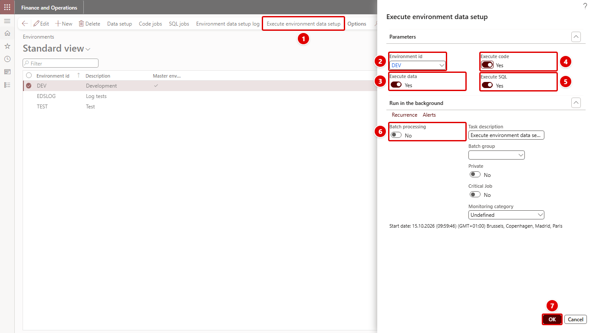

[← Return to README](../README.md)

# Executing the setup

**System administration > Setup > Environment data setup > Execute environment data setup**, or the button of the same name in [Environments](environments.md) (action menu item `OLK_EnvironmentDataSetupExecute`)

Run this in the target environment after its database was refreshed, for example in UAT after a copy from PROD.

The red numbers in each screenshot match the numbered steps below it.

1. In [Environments](environments.md), select the environment and click **Execute environment data setup**.
2. **Environment id** is filled in from the selected environment.
3. **Execute data**: Yes to write the data setup lines.
4. **Execute code**: Yes to run the active code jobs.
5. **Execute SQL**: Yes to run the active SQL jobs.
6. **Batch processing**: optionally run it in batch.
7. Click **OK**.

## The dialog

| Parameter | Description |
| --- | --- |
| Environment id | The environment to execute. Filled in when started from Environments. Required, and it must exist. |
| Execute data | Write the field values from [Data setup](data-setup.md). |
| Execute code | Run the active [code jobs](code-jobs.md). |
| Execute SQL | Run the active [SQL jobs](sql-jobs.md). |

The dialog is a standard SysOperation dialog, so it can also be run in batch.

Encrypted values of an environment can be decrypted only in that environment, so run the setup of the environment you are in. See [After the refresh](encryption.md#after-the-refresh).

## Order

1. All data setup lines of the environment.
2. All active code jobs of the environment.
3. All active SQL jobs of the environment.

Only what is selected runs: active code jobs do not run when **Execute code** is No, and the same for SQL. Lines and jobs of other environments are never touched.

## Companies

Each line or job runs in its own company (**Company**). Lines and jobs without a company run in the company the setup is executed in.

## Errors

Each data line, code job and SQL job runs on its own. When one fails, its error and the infolog messages it produced are written to the [log](log.md) with status Error, and the execution continues with the next one. Check the log after every run.

## Implementation

| Class | Role |
| --- | --- |
| `OLK_EnvironmentDataSetupExecuteController` | Opens the dialog; fills in the environment when started from an environment record. |
| `OLK_EnvironmentDataSetupExecuteContract` | The dialog parameters and their validation. |
| `OLK_EnvironmentDataSetupExecuteService` | Runs the data lines, code jobs and SQL jobs and writes the log. |
| `OLK_EnvironmentDataSetupValueConverter` | Converts the stored text to the field's type. |
| `OLK_EnvironmentDataSetupEncryptedField` | Writes encrypted values through an edit method, for lines that have one. |
