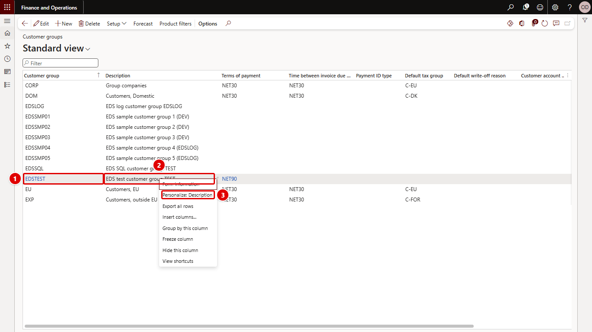
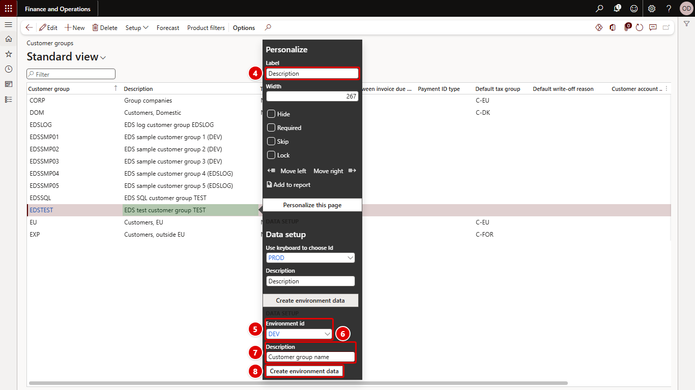
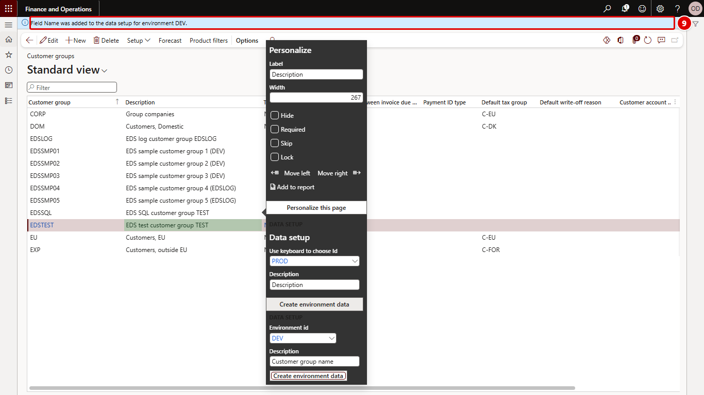
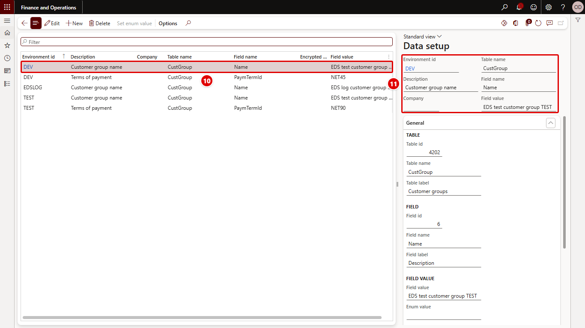

[← Return to README](../README.md)

# Adding data setup lines from any form

The model extends the standard Personalize pop-up (form `FormControlQuickPersonalization`) with a group that adds a field to the [data setup](data-setup.md) in two clicks.

## How to use it

The red numbers in each screenshot match the numbered steps below it.

The example adds the name of customer group `EDSTEST` to the data setup of environment `DEV`.

1. Open **Customer groups** and select the row **EDSTEST**.
2. Right-click the **Description** field of that row.
3. Select **Personalize: Description**.

4. The Personalize pop-up opens with focus in **Label**.
5. Press **Tab** until the focus is on **Environment id** in the **Data setup** group (9 times on a standard installation), or click the field. It is proposed as the [master environment](environments.md).
6. Type the environment id, for example `DEV`, and press **Tab**. Do not pick the value from the lookup list that opens: selecting from it collapses the pop-up to an empty frame.
7. In **Description**, keep the proposed label or type a description, for example `Customer group name`.
8. Press **Tab** to reach **Create environment data** and press **Enter**, or click the button.

9. The message bar confirms *Field Name was added to the data setup for environment DEV.* The field and its current value are now in the data setup of that environment.

10. Open [Data setup](data-setup.md). The new line is in the list.
11. The header shows the environment, description, company, table, field and the stored value. Change **Field value** to what the environment needs.

If the same field of the same record is already in the data setup of that environment, its value is replaced with the current value.

## When the group is shown

The group is shown only when all of these hold:

- the control is bound to a data source;
- the configuration key **OLK Environment data setup** (`OLK_EdsConfigKey`) is on;
- the user has access to the Data setup menu item (see [Security](security.md)).

## Encrypted fields

Encrypted fields are shown through edit methods. For such a control the line is created as an encrypted line with the edit method's name and no value; enter the value in the Data setup form.

To encrypt the value of a normal field, create the line here and then set **Encrypted field** to Yes in the Data setup form. See [Encrypting a normal field](encryption.md#encrypting-a-normal-field).

If the control is bound neither to a table field nor to an edit method, or no record is selected, the button reports *The control is not bound to a table field or an edit method.*

## Implementation

| Object | Role |
| --- | --- |
| `FormControlQuickPersonalization.OLK_Eds_Extension` (form extension) | Adds the group with Environment id, Description and the Create environment data button. |
| `FormControlQuickPersonalization_Form_OLK_Eds_Extension` (class) | Shows or hides the group and fills in the defaults when the pop-up opens. |
| `OLK_EnvironmentDataSetupQuickPersonalizationHelper` | Handles the button and gives the default environment and description. |
| `OLK_EnvironmentDataSetupTrans::createFromControl` / `createTrans` | Create or update the data setup line. |
