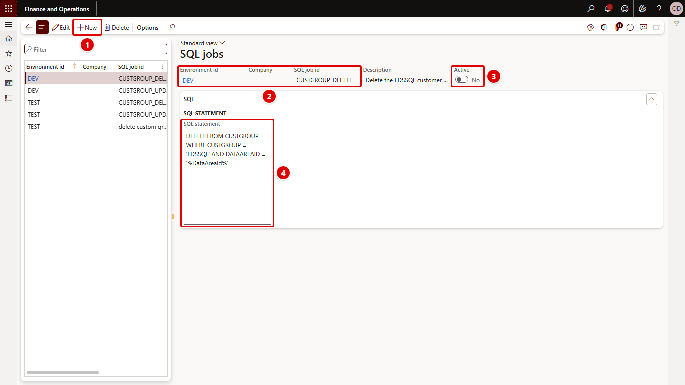

[← Return to README](../README.md)

# SQL jobs

**System administration > Setup > Environment data setup > SQL jobs** (form `OLK_EnvironmentDataSetupSQL`, table `OLK_EnvironmentDataSetupSQL`)

A SQL job is one SQL statement that runs directly against the database when the setup is [executed](execute.md) with **Execute SQL**. Use it for bulk changes that would be slow or impossible record by record.

The red numbers in each screenshot match the numbered steps below it.



1. Click **New** to add a SQL job.
2. Enter **Environment id**, **Company** and **SQL job id**; together they identify the job.
3. Set **Active**. Only active jobs run.
4. Enter the **SQL statement**. `%DataAreaId%` is replaced with the company.

## Fields

| Field | Description |
| --- | --- |
| Environment id | The [environment](environments.md) the job belongs to. |
| Company | The company the job is for. Empty means the company the setup is executed in. |
| SQL job id | Identifies the job, up to 20 characters. Unique per environment and company. |
| Description | What the job does. |
| Active | Only active jobs run. |
| SQL statement | The statement. |

## Allowed statements

Only a single `UPDATE`, `INSERT` or `DELETE` statement is allowed. One trailing semicolon is accepted; anything after a semicolon would be a second statement and is refused. Other statements are refused with *Only a single UPDATE, INSERT or DELETE statement is allowed.*, both when you save the job and again when it is executed.

## `%DataAreaId%`

`%DataAreaId%` in the statement is replaced with the job's company in lower case, or with the current company when the job has none:

```sql
UPDATE CUSTGROUP SET NAME = 'UAT customers' WHERE CUSTGROUP = '10' AND DATAAREAID = '%DataAreaId%'
```

## At execution

- The statement runs directly on SQL Server, outside X++ business logic: no `validateWrite`, no `update()` overrides, no table cache refresh, no database log. Use [Data setup](data-setup.md) or a [code job](code-jobs.md) when those matter.
- Each job writes one line to the [log](log.md): type SQL, id = SQL job id, and as value the number of rows affected. A statement that matches no rows is not an error; the log shows `0`.
- A statement that SQL Server rejects is logged as Error with the reason, and the other jobs still run.

The **Maintain environment data setup** privilege is what lets a user write statements here, so grant it with care (see [Security](security.md)).
